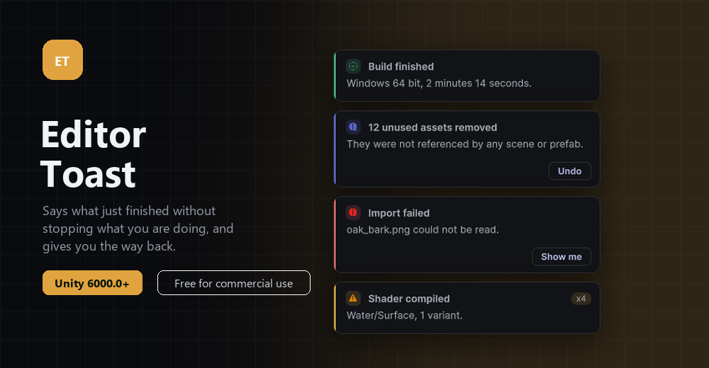

<p align="center">
  
</p>

<h3 align="center">Toast notifications for the Unity editor, for saying something without stopping the work.</h3>

## Install

Unity 6000.0 or newer.

**In the Package Manager**

1. Open `Window > Package Manager`
2. Press **+**, then **Install package from git URL**
3. Paste this and press Add:

```
https://github.com/CookieJarTools/EditorToast.git
```

**Or by hand**, put this line in `Packages/manifest.json`:

```json
"com.cookiejartools.editortoast": "https://github.com/CookieJarTools/EditorToast.git"
```

<p align="center">
  
</p>

## Using it

```csharp
ToastManager.ShowNotification(new ToastArgs
{
    Title = "Hello World",
    Message = "Hello World!",
    LifeTime = 5f,
    Severity = ToastSeverity.Info,
    ToastPosition = ToastPosition.BottomRight,
});
```

`LifeTime` is in seconds. `Severity` tints it. `ToastPosition` puts it in any of the four corners.

**A sound, if you want one.** Put an mp3 at `Assets/Audio/NotificationSound.mp3` and it plays when
a notification appears.

## Worth knowing

This is Windows only at the moment, and it has been tested on one machine, so treat it as something
that works rather than something that is guaranteed to. Built against Unity 6000.0.38f1.

It was written for the other CookieJar tools to use, and it is just as happy being used by yours.

## Licence

Free for noncommercial use under the PolyForm Noncommercial License 1.0.0.
Commercial use needs a licence, so get in touch. See [LICENSE.md](LICENSE.md).
